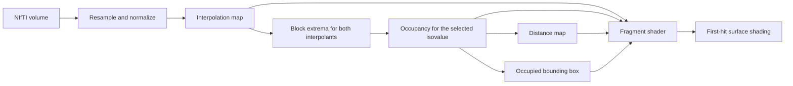

# ISOViewer project overview

ISOViewer is a browser-based research viewer for scalar medical volumes. For each pixel, a WebGL fragment shader casts a ray through a NIfTI volume and locates the nearest point where the interpolated intensity equals the selected isovalue. The Three.js box is proxy geometry for launching those rays. The surface is implicit, so changing the isovalue selects a different level set of the same interpolated field.

The implementation has two GPU workloads. TensorFlow.js runs custom WebGL kernels to prepare interpolation and acceleration maps at load time and when relevant settings change. Three.js uploads the resulting 3D textures and runs the per-frame ray caster while the user moves the camera.

## Head and neck CTA demo

| Volume detail | Voxel grid | Compressed download |
| --- | --- | --- |
| Preview, loaded at startup | 256 × 256 × 148 | 10.8 MiB |
| High detail, loaded on request | 410 × 410 × 236 | 83.8 MiB |

The demo starts at normalized isovalue 0.35 with block size 2, Csébfalvi tricubic interpolation, triquadratic B-spline gradients, digital differential analyzer (DDA) traversal, and grouped anisotropic block skipping. Bounding-box clipping and Bernstein rejection start enabled. The threshold and camera pose carry across detail levels. Both grids preserve the scan's physical extent and use the same normalized intensity range. The preview is generated offline from the source scan with trilinear resampling, and the high-detail path resamples the source at a factor of 0.8 on the GPU. [Scan sources](src/javascript/sources.js) · [Viewer defaults](src/javascript/Utils/Configs.js) · [Preview generator](scripts/generate-cta-preview.mjs)

The repository retains cardiac CT and MR images and labels and colon data and a mask for development. The deployed demo ships the two head-and-neck CTA assets. The viewer renders a scalar intensity field. [Bundled volumes](static/nifti)

**Open scan** reads a single 3D scalar NIfTI volume (`.nii` or `.nii.gz`) from the device without sending it to a server. Local scans use the selected grid's min and max for normalization. The viewer reduces large grids to its high-detail voxel budget and preserves the scan's physical proportions. If the header leaves the spatial units unspecified, the viewer interprets the spacing in millimeters. [Local file loading](src/javascript/Utils/Resources.js) · [NIfTI parser](src/javascript/Utils/NIFTILoader.js)

The associated publication is *High-Quality Analytic Isosurface Rendering for Web-Based Cardiac Imaging*, presented at IEEE BIBE 2025. Its cardiac imaging context and results are described in the README. The repository also contains a paper PDF, references, and sample renderings. [Publication and demo](readme.md) · [Research material](static/paper) · [Sample renderings](static/images)

## From NIfTI to the first frame

`Experience.loadQuality()` starts TensorFlow.js on the WebGL backend while streaming the selected CTA asset. It reports download and preprocessing progress through the interface, waits for `Computes` to build the maps, and establishes the first view or updates the existing material. A failed detail download leaves the previous view available. The application exposes `window.experience` for inspection. [Entry point](src/script.js) · [Application lifecycle](src/javascript/Experience.js) · [Map orchestration](src/javascript/Computes/Computes.js)

1. **Load the voxel grid.** The resource loader uses browser-native gzip streaming where available. The NIfTI loader handles fallback decompression, then reads the scalar voxel buffer, dimensions, and pixel spacing. The renderer works in voxel axes, uses spacing in meters for physical proportions, and uses raw stored scalar values for normalization. [Resource loader](src/javascript/Utils/Resources.js) · [NIfTI parser](src/javascript/Utils/NIFTILoader.js)
2. **Resample and normalize.** `VolumeMap` converts the data to a float32 tensor in `[z, y, x]` order. When the output grid differs, a GPU trilinear kernel resamples to `ceil(originalDimension × downscaleFactor)` and spacing is adjusted to preserve the physical extent. Both CTA grids use the stored range 0 to 4095 to define the slider's `[0, 1]` scale. [VolumeMap.js](src/javascript/Computes/Maps/VolumeMap.js)
3. **Prepare both interpolants.** Each voxel stores RGB second differences along x, y, and z and the normalized intensity in alpha. The fragment shader gets standard trilinear interpolation from the hardware-filtered alpha channel. The Csébfalvi path uses the same filtered fetch and combines all four channels with quadratic position-dependent weights. Both read a linearly filtered `RGBA16F` texture. [InterpolationMap.js](src/javascript/Computes/Maps/InterpolationMap.js) · [Tricubic sampler](src/shaders/iso_viewer/chunks/functions/sample_value/sample_value_tricubic.glsl)
4. **Bound the possible surface by blocks.** The extrema pass stores two min/max pairs per block. Trilinear bounds come from cell corners. Tricubic bounds come from Bernstein coefficients that account for overshoot between samples. The kernel converts along x, y, and z in succession so it can reuse intermediate coefficients. It aggregates the cell bounds and pads the block ranges. Occupancy marks a block as a candidate if its range contains the isovalue. The occupied bounding box comes from a scan over the same byte array used for the occupancy texture. [Extrema kernel](src/javascript/Computes/Programs/GPGPUExtremaMapFusedPacked.ts) · [OccupancyMap.js](src/javascript/Computes/Maps/OccupancyMap.js)
5. **Build and upload the skip data.** The selected distance transform derives block-space distances from occupancy. TensorFlow.js runs the packed WebGL kernels. The maps read back into typed arrays and are uploaded as Three.js `Data3DTexture` objects. The extrema tensor is retained for rethresholding. Native `Float16Array` conversion builds the half-float interpolation texture where supported, with the GPU conversion as a fallback. The interpolation tensor is then released. [Map classes](src/javascript/Computes/Maps) · [Compute kernels](src/javascript/Computes/Programs)

### Empty-space skipping modes

The distances describe empty regions in the block grid around candidate blocks. They let the ray advance to the exit face of a larger empty region in one step. All of the block textures use nearest-neighbor access.

| Mode | What the traversal reads | Texture |
| --- | --- | --- |
| Occupancy | One candidate flag per block. Empty blocks are crossed individually. | `R8UI` |
| Isotropic distance | One Chebyshev distance per block, shared across ray directions. | `R8UI` |
| Anisotropic distance | One Chebyshev distance per block and ray octant. The eight octant volumes are stacked along texture depth. | `R8UI` |
| Extended isotropic distance | Positive and negative per-axis skip distances and occupancy, with one packed word for each sign. | `RG16UI` |
| Extended anisotropic distance | A packed word containing three per-axis skip distances and occupancy per block and octant. The octant volumes are stacked along texture depth. | `R16UI` |

The extended modes encode three five-bit distances and one occupancy bit in each 16-bit word. The shader's texture formats, packing, octant order, and block coordinate conventions must agree with the compute outputs. [Distance samplers](src/shaders/iso_viewer/chunks/functions/sample_distance) · [Block traversal](src/shaders/iso_viewer/chunks/march/modules/march_blocks)

## How the shader finds and shades a hit

[ISOViewer.js](src/javascript/World/ISOViewer/ISOViewer.js) binds the textures, dimensions, spacing, isovalue, and bounding box. [ISOMaterial.js](src/javascript/World/ISOViewer/ISOMaterial.js) creates a GLSL 3 material for the back faces of the proxy box. The box has the volume's physical proportions in world space. The vertex shader transforms the camera and ray into voxel-grid coordinates, where the fragment shader clips the search interval to the volume and uses the occupied bounding box when that option is enabled and the ray intersects it.

- **DDA traversal** advances between cell faces. Within a cell, the ray-restricted trilinear field yields a cubic residual polynomial. The Csébfalvi interpolant used here yields a quintic because its trilinearly filtered features are weighted by quadratic corrections. The shader samples the field or features to reconstruct coefficients. Optional Bernstein rejection can rule out candidate cells before further root testing. The hit routine chooses the nearest solved root within the cell. [Cell marching](src/shaders/iso_viewer/chunks/march/modules/march_cells)
- **Uniform stepping** samples at regular intervals along each trace, looks for a residual sign change, and refines the bracket. Both traversal methods can run directly over the ray or inside regions selected by the block-skipping code. The grouped strategy batches block advances before entering fine traversal. Traversal bounds and method switches are supplied as shader defines. [Trace marching](src/shaders/iso_viewer/chunks/march/modules/march_traces) · [March dispatcher](src/shaders/iso_viewer/chunks/march/compute_march.glsl)
- **Shading** uses the field gradient and Hessian at the first hit to orient the normal and estimate principal curvatures. The selected palette maps the requested isovalue to a consistent material color across the surface. The five tinted ramps preserve their original colors at the demo's opening isovalue of 0.35. Camera-aligned lighting has separate gradient-strength and curvature modulation switches. The normal can use the analytic interpolant, a Sobel filter, or B-spline filters. [Hit and gradient functions](src/shaders/iso_viewer/chunks/functions) · [Shading shader](src/shaders/iso_viewer/chunks/shade/compute_shade.glsl)

The fragment entry point assembles ray setup, marching, shading, and debug views from [viewer shader chunks](src/shaders/iso_viewer/chunks). The repository also contains a [shared GLSL utility library](src/shaders/utils), including alternative filters and solvers. The active include chain determines which utilities are part of a shader variant.

## Controls and recomputation

The Slate Blue Research Workbench places a pinned isovalue and four control tabs on the left, the original charcoal viewport on the right, and grid readouts, a Debug shortcut, and FPS below. **Surface** groups palettes, normals, and lighting. **Render** groups ray casting and acceleration. **Scan** holds volume detail and source settings. **Debug** groups diagnostic views, missed-ray display, root solvers, and voxel spacing. The viewport toolbar switches between shaded surface, normals, and curvature displays. Fly mode uses `ProbeControls` with keyboard focus on the viewport and shows the Space and Shift speed controls. [Camera controls](src/javascript/Camera.js) · [Fly controls](src/javascript/Utils/ProbeControls.js) · [Interface](src/javascript/GUI.js) · [Control tabs](src/javascript/Utils/ControlPanels.js) · [Inspector styles](src/inspector.css)

| Setting change | Compute and render effect |
| --- | --- |
| Isovalue or interpolation method | Reuse the extrema tensor. Recalculate occupancy, the selected distance map, and the occupied box. Refresh texture contents and the relevant shader state. |
| Skipping method | Select and build the required distance texture. Block occupancy mode reuses the occupancy texture directly. |
| Volume detail, block size, or downscale factor | Recompute the volume and dependent maps and refresh the material for the new grid. The previous textures stay available while the replacement is prepared. |
| Marching, gradient, intersection, or acceleration switches | Update shader defines. Changing colormap or shading values updates uniforms. |

Settings go through `Configs.set()` and are applied together on the next frame. The viewer redraws when the camera, settings, or viewport changes. During camera motion, the drawing buffer runs at 72% of its normal linear resolution and returns to full size after settling. The FPS counter counts submitted frames over short windows and clears when drawing stops. **Measure FPS** opts into continuous drawing at rest. The regular ray-casting path skips shading for missed rays and compiles out diagnostic counters. [Render lifecycle](src/javascript/Experience.js) · [Viewport sizing](src/javascript/Utils/Sizes.js) · [Frame sampler](src/javascript/Utils/Stats.js)

## Running and checking changes

Use a recent Node.js release and desktop Chrome or another desktop browser with GPU-accelerated WebGL2. From the repository root, run `npm ci` and `npm run dev`, then use the address printed by Vite. [package.json](package.json) · [Vite configuration](vite.config.js)

Vite treats `src/` as the app root. A normal `npm run build` regenerates `docs/` for GitHub Pages with the two imported CTA assets, the interface, and the rendering code. For a build check with separate output, run `npm run build -- --outDir <absolute-scratch-directory>`.

In a local Chrome run on a Radeon RX 9060 XT, the preview reached a visible first frame in about 2.0 seconds. The previous source build, which started with the larger grid and scan download, took about 6.1 seconds on the same setup. At the original 410 × 410 × 236 grid and isovalue 0.3, the revised and original implementations produced matching occupancy checksums, occupied block counts, and bounds. TensorFlow.js still emitted a high GPU memory diagnostic during startup.

