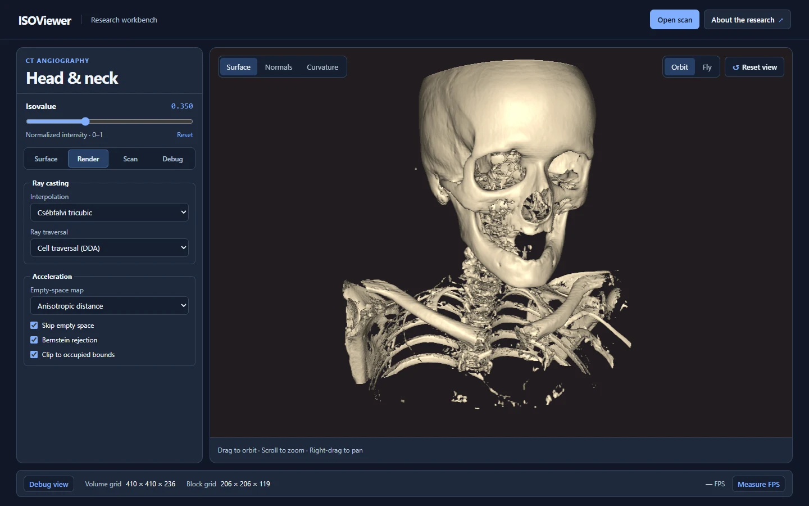
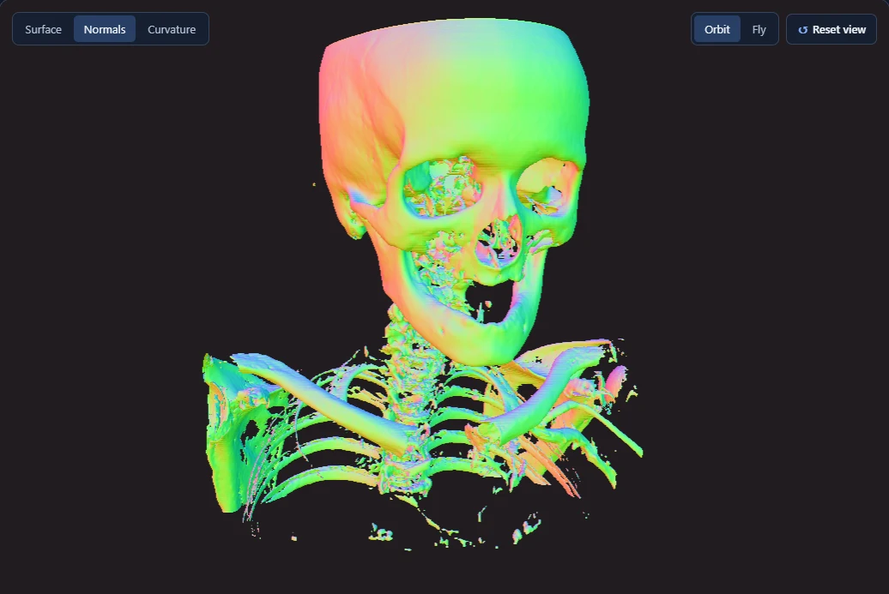
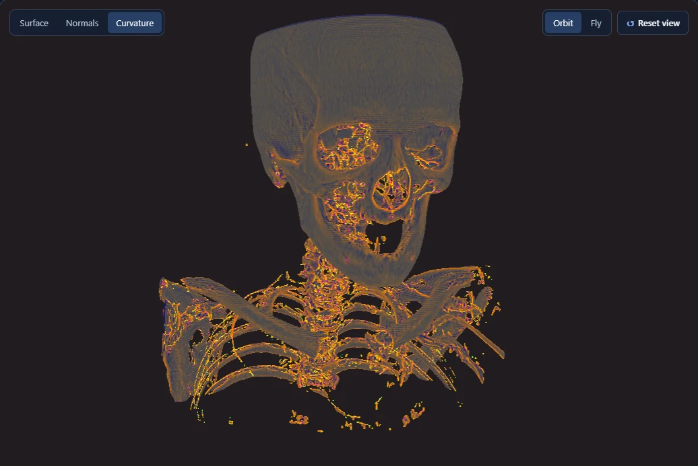

# ISOViewer

ISOViewer is a browser-based research viewer for **3D medical images**. The demo opens a head-and-neck CT angiogram and lets you explore its isosurfaces by changing the intensity threshold. The renderer uses WebGL2, Three.js, and TensorFlow.js.

[Open the demo](https://xaralampidisbasilis.github.io/ISO-Viewer/) · [Read the paper](https://doi.org/10.1109/BIBE66822.2025.00019) · [Project architecture](PROJECT_OVERVIEW.md)



*High-detail CTA at isovalue 0.350 with tricubic interpolation and anisotropic distance skipping.*

## Explore the demo

1. Open the viewer in a browser with GPU-accelerated WebGL2. It starts with a **10.8 MiB preview**. Under **Scan**, choose **High detail** to load the 84 MiB source scan.
2. Drag in **Orbit** mode to rotate, scroll or pinch to zoom, and right-drag to pan. **Reset view** returns to the opening angle.
3. Use **Isovalue** to select a surface at a different normalized intensity. Try **Normals** and **Curvature** above the scan to inspect the same surface in different ways.
4. Select **Open scan** to load a single 3D NIfTI file (`.nii` or `.nii.gz`). The file is processed locally in the browser. Use **Return to CTA demo** in the **Scan** tab to reopen the bundled volume.

| Workbench tab | Controls |
| --- | --- |
| **Surface** | Palette, normal estimation, and independent gradient and curvature shading switches |
| **Render** | Trilinear or tricubic interpolation, cell traversal or uniform stepping, and empty-space skipping |
| **Scan** | Preview or high detail, local scan status, and return to the demo |
| **Debug** | Shader diagnostic views, traversal counters, cell root solvers, and voxel spacing |

In **Fly** mode, click the viewport to focus it. Drag to look around. Use **W/A/S/D** to move, **R/F** to move up or down, **Q/E** to roll, and the **arrow keys** to rotate. Hold **Space** to speed up or **Shift** to slow down.

The status bar shows FPS during sustained interaction. Turn on **Measure FPS** to sample continuously at rest. Turn it off to return to rendering on demand.

## Diagnostic views

| Surface normals | Principal curvatures |
| --- | --- |
|  |  |

Both images use the same high-detail grid, camera, and isovalue. The normal view encodes surface orientation. The curvature view highlights how the surface bends based on its two principal curvatures.

## How the renderer works

1. **Prepare the volume.** TensorFlow.js WebGL kernels prepare the interpolation texture and bounds for groups of cells. When the isovalue changes, the bounds identify which blocks could contain the surface.
2. **Skip empty space.** The renderer clips rays to the occupied bounds and uses distance maps to advance over empty blocks. An optional Bernstein coefficient test rejects cell segments that cannot contain a crossing.
3. **Find and shade the intersection.** In cell-traversal mode, the fragment shader solves for the nearest surface crossing within a cell. The viewer shades that first hit directly from the volume data without building a triangle mesh.

The [project overview](PROJECT_OVERVIEW.md) describes the GPU pipeline, texture formats, and acceleration methods in more detail.

## Run locally

Use a recent Node.js release and a browser with GPU-accelerated WebGL2.

```bash
npm ci
npm run dev
```

Open the address printed by Vite. Run `npm run build` to regenerate the GitHub Pages build in `docs/`. To recreate the preview volume from the bundled CTA, run `node scripts/generate-cta-preview.mjs` before building.

## Publication

**High-Quality Analytic Isosurface Rendering for Web-Based Cardiac Imaging**

Vasileios Lazaros Charalampidis, M. Louis Handoko, Eduard Ródenas-Alesinao, Folkert W. Asselbergs, Konstantinos Votis, Paschalis Bizopoulos, and Andreas Triantafyllidis. IEEE BIBE 2025, pp. 63–70.

The paper reports 25–45 FPS on the cardiac CT volumes used in the study and up to a 1.5× speedup from Bernstein-based early rejection in its reported tests. The current demo applies the rendering approach to a head-and-neck CTA. [Published paper](https://doi.org/10.1109/BIBE66822.2025.00019) · [Open-access manuscript](https://discovery.ucl.ac.uk/id/eprint/10227221/)

## License

[MIT License](LICENSE.txt)
